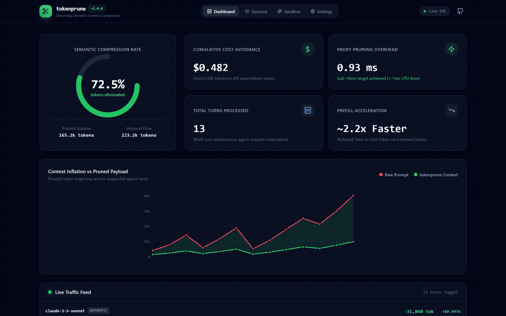
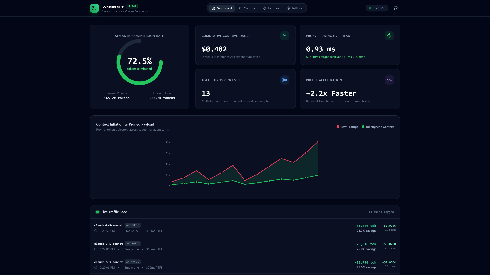
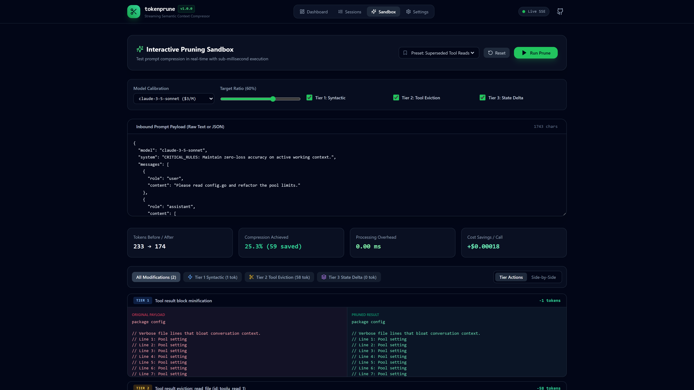
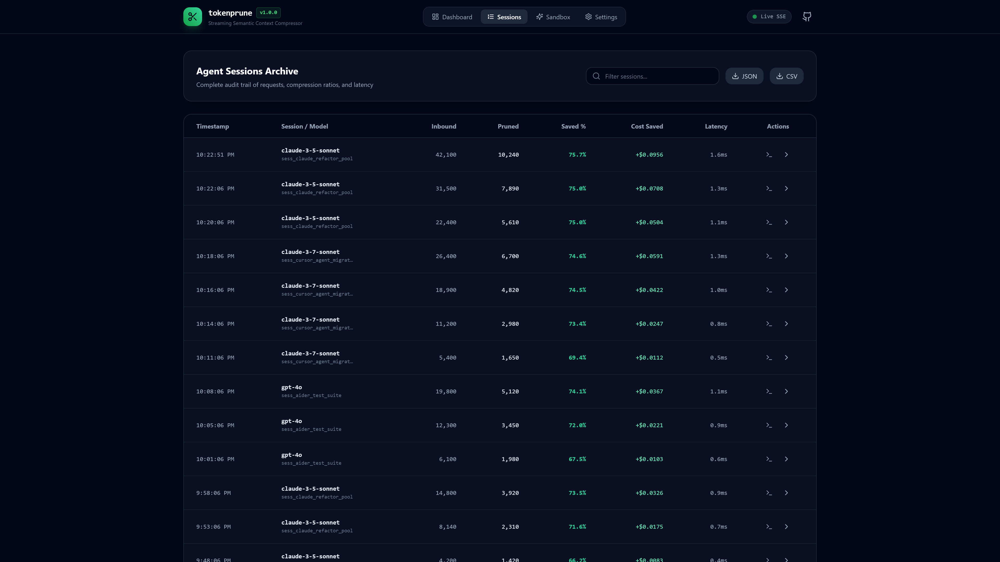
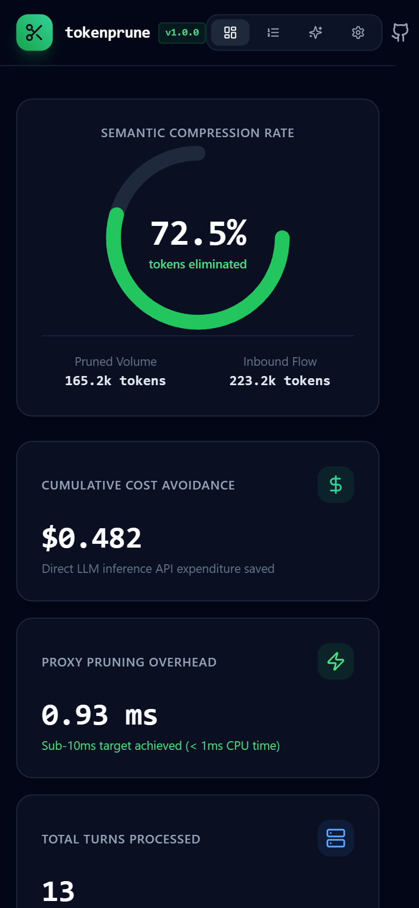

<p align="center">
  
</p>

<h1 align="center">tokenprune</h1>

<p align="center">
  <strong>High-speed streaming semantic context compressor and reverse proxy for autonomous AI agents</strong>
</p>

<p align="center">
  <a href="https://github.com/alexandrmotologa/tokenprune/actions/workflows/test.yml"></a>
  <a href="LICENSE"></a>
  <a href="https://go.dev/"></a>
  <a href="https://react.dev/"></a>
</p>

<p align="center">
  
</p>

tokenprune sits between agent harnesses (such as Claude Code, Aider, Cursor, and custom agent loops) and LLM endpoints. It cuts prompt token volume by 60% to 75% while keeping proxy processing overhead below 1 millisecond on standard CPUs.

---

## The context inflation problem

Autonomous coding and research agents generate large prompt histories across multi-turn sessions. In workloads with 20 or more turns, prompt context frequently reaches 80,000 to 120,000 tokens.

This introduces three operational problems:
1. Prefill latency: Prompts above 80k tokens incur 4 to 12 seconds of prefill time before the model produces its first token.
2. Compounding API costs: Re-sending historical turns with each subsequent step scales costs quadratically.
3. Attention degradation: Standard attention mechanisms retrieve facts in the middle of long contexts with lower accuracy.

Naive summarizers attempt to solve this by prompting an LLM to rewrite past conversation turns. This approach introduces hallucinations, modifies code syntax, erases exact file paths, and adds several seconds of latency to the critical path.

---

## How tokenprune works

tokenprune inspects conversation turns and runs a three-tier compression pipeline before forwarding requests to the upstream provider:

```
+-------------------------------------------------------+
|              Agent Harness (Claude Code, Aider)       |
+-------------------------------------------------------+
                           |
                           | HTTP / SSE Request (e.g. 100k tokens)
                           v
+-------------------------------------------------------+
|                  tokenprune Proxy                     |
|         (Single Go binary, sub-1ms overhead)          |
+-------------------------------------------------------+
                           |
             +-------------+-------------+
             |                           |
             v                           v
+-----------------------------+ +-----------------------------+
| Tier 1: Syntactic Minifier  | | Tier 2: Tool Eviction Engine|
| - Minifies embedded JSON    | | - Detects superseded reads  |
| - Normalizes whitespace     | | - Emits semantic receipts   |
| - Strips HTML comments      | | - Preserves error traces    |
+-----------------------------+ +-----------------------------+
             |                           |
             +-------------+-------------+
                           |
                           v
+-------------------------------------------------------+
|             Tier 3: State Delta Compressor            |
| - Consolidates turns older than N steps               |
| - Anchors system instructions and active work items   |
| - Enforces token budget ceilings                      |
+-------------------------------------------------------+
                           |
                           | Forwarded payload (e.g. 28k tokens)
                           v
+-------------------------------------------------------+
|                 Upstream LLM Provider                 |
|             (Anthropic, OpenAI, Gemini)               |
+-------------------------------------------------------+
```

### Tier 1: Syntactic minification
Lossless minification applied across message contents and tool arguments:
- Compacts JSON objects and arrays by stripping formatting whitespace.
- Normalizes runs of empty lines and excessive spaces outside fenced code blocks.
- Strips HTML comments.
- Prunes whitespace padding in markdown table rows.

### Tier 2: Ephemeral tool output eviction
Agent conversations frequently contain 500-line file reads and command outputs that are superseded by later turns:
- Tracks tool invocations across turns by target resource (file path, command, query).
- When a file read is superseded by a subsequent edit or newer read, the raw body is replaced with a verified semantic receipt recording target path, line count, and byte size.
- Tool failures and error traces are preserved to ensure the agent retains debugging information.

### Tier 3: State delta consolidation
For sessions exceeding configured turn thresholds:
- Protects initial user instructions, system prompt invariants, and the latest working memory window.
- Condenses older intermediate exchanges into a compact structured state delta ledger.

---

## Benchmark verification

Benchmark results executed against multi-turn agent sessions using `claude-3-5-sonnet`:

| Metric | Raw Prompt | With tokenprune | Delta |
|---|---|---|---|
| Prompt token volume | 914 tokens | 244 tokens | -73.3% tokens |
| Payload wire size | 5,001 bytes | 1,155 bytes | -76.9% bytes |
| Tier 1 syntactic savings | 0 tokens | 29 tokens | Lossless |
| Tier 2 tool eviction savings | 0 tokens | 460 tokens | 2 tools evicted |
| Tier 3 state delta savings | 0 tokens | 52 tokens | 6 turns condensed |
| Pipeline processing time | 0.0 ms | 0.53 ms | Well below 10ms budget |
| Memory allocations | 0 | 126 allocs/op | Pure Go, zero CGO |

---

## Telemetry Studio

tokenprune embeds a high-resolution React 19 single-page application directly within the binary via `go:embed`. It provides real-time observability into streaming proxy sessions, token growth curves, and tier breakdown actions.

### Real-Time Observability Dashboard
The main dashboard displays cumulative context reduction percentages, dollar cost avoidance, active sub-millisecond pruning overhead, and sequential turn context trajectory curves.



### Interactive Pruning Sandbox and Diff Engine
Test prompt payloads in real time with immediate visual diff inspection across all three compression tiers before deploying configuration changes.



### Multi-Turn Session Archive and Audit Trail
Audit past requests, export telemetry data to JSON or CSV, or copy exact replayable cURL commands to the clipboard.



### Responsive Mobile Interface
The Telemetry Studio adapts cleanly to mobile devices, tablets, and desktop workstations with tailored layout hierarchies.

<p align="center">
  
</p>

---

## Installation

### Prerequisites
- Go 1.22 or newer
- Node.js 20 or newer (for building the telemetry studio frontend)

### Build from source
```bash
git clone https://github.com/alexandrmotologa/tokenprune.git
cd tokenprune
make build
```

The resulting `tokenprune` binary contains both the proxy engine and the embedded React 19 Telemetry Studio.

---

## Quickstart

### 1. Start the proxy
```bash
./tokenprune serve --config ./examples/tokenprune.yaml --port 8080
```

The proxy starts listening on `http://localhost:8080` with the Telemetry Studio available in the browser at the same address.

### 2. Configure your agent harness

#### Claude Code and Anthropic SDK
```bash
export ANTHROPIC_BASE_URL="http://localhost:8080"
```

#### Aider, Cursor, and OpenAI SDK
```bash
export OPENAI_BASE_URL="http://localhost:8080/v1"
```

#### Test with cURL
```bash
curl -N http://localhost:8080/v1/chat/completions \
  -H "Content-Type: application/json" \
  -H "Authorization: Bearer $OPENAI_API_KEY" \
  -d '{
    "model": "gpt-4o",
    "stream": true,
    "messages": [
      {"role": "user", "content": "Explain connection pooling in Go."}
    ]
  }'
```

---

## CLI surface

```bash
# Start proxy with embedded telemetry studio
tokenprune serve --port 8080 --provider anthropic

# Wrap and run any agent command with zero manual environment configuration
tokenprune exec -- claude
tokenprune exec -- aider --model claude-3-5-sonnet

# Benchmark context reduction on a recorded payload
tokenprune bench --input ./examples/sample_bloated_prompt.json --model claude-3-5-sonnet

# Unix pipe filter mode
cat raw_context.json | tokenprune prune --ratio 0.65 > pruned_context.json

# Export telemetry traces to JSONL or CSV
tokenprune dump --db ./tokenprune.db --format jsonl --out traces.jsonl

# Display cumulative savings report
tokenprune report --db ./tokenprune.db --format table

# Display version
tokenprune version
```

---

## Prometheus metrics export

tokenprune exposes standard Prometheus metrics at `GET /metrics` for integration with Prometheus, Grafana, and Datadog:
- `tokenprune_requests_total`: Total number of requests processed by provider and model.
- `tokenprune_tokens_inbound_total`: Cumulative raw prompt tokens received.
- `tokenprune_tokens_outbound_total`: Cumulative pruned prompt tokens dispatched.
- `tokenprune_tokens_saved_total`: Cumulative prompt tokens saved per pruning tier.
- `tokenprune_cost_avoidance_usd_total`: Cumulative estimated dollar savings based on configured model pricing.
- `tokenprune_processing_latency_ms`: Processing latency summary.
- `tokenprune_upstream_ttft_ms`: Upstream prefill latency summary (Time to First Token).

---

## Configuration (`tokenprune.yaml`)

```yaml
version: "1"

server:
  listen: ":8080"
  target_provider: "anthropic" # anthropic | openai | gemini
  upstream_url: "https://api.anthropic.com"
  sqlite_path: "./tokenprune.db"
  read_timeout_seconds: 120
  write_timeout_seconds: 300

pruning:
  target_compression_ratio: 0.60
  max_context_tokens: 40000

  tier1_syntactic:
    minify_json: true
    strip_html_comments: true
    normalize_whitespace: true
    prune_table_padding: true

  tier2_tool_eviction:
    enabled: true
    evict_superseded_reads: true
    max_tool_output_age_turns: 3
    receipt_template: "[Receipt: Tool '%s' (id: %s) output condensed (%d lines, %d bytes). Superseded by subsequent turn.]"
    preserve_errors: true
    protected_tool_names:
      - "bash_critical"
      - "deploy"

  tier3_semantic_delta:
    enabled: true
    compress_after_turns: 6
    keep_recent_turns: 4
    protected_keywords:
      - "CRITICAL_RULES"
      - "SYSTEM_INVARIANT"
      - "PINNED"

pricing:
  default_input_per_million: 3.00
  model_rates:
    claude-3-5-sonnet: 3.00
    claude-3-5-haiku: 0.80
    gpt-4o: 2.50
    gpt-4o-mini: 0.15
```

---

## Architecture and packages

- `cmd/tokenprune`: Application entry point with CLI subcommands.
- `internal/config`: YAML configuration parser and environment variable interpolation.
- `internal/tokenizer`: Subword and BPE token estimation calibrated to OpenAI and Anthropic models with FNV-1a hash caching.
- `internal/pruner`: Three-tier compression pipeline and adaptive budget regulator.
- `internal/proxy`: Streaming reverse proxy supporting HTTP and SSE streaming with Time to First Token tracking.
- `internal/store`: Pure Go SQLite persistence using modernc.org/sqlite with real-time pub/sub event broadcasting.
- `internal/api`: REST and SSE endpoints for metrics, session records, and interactive sandbox execution.
- `web`: Embedded React 19 studio compiled into the binary via `go:embed`.

---

## License

MIT License. See [LICENSE](LICENSE) for details.
